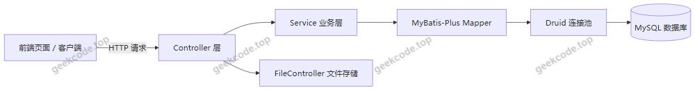
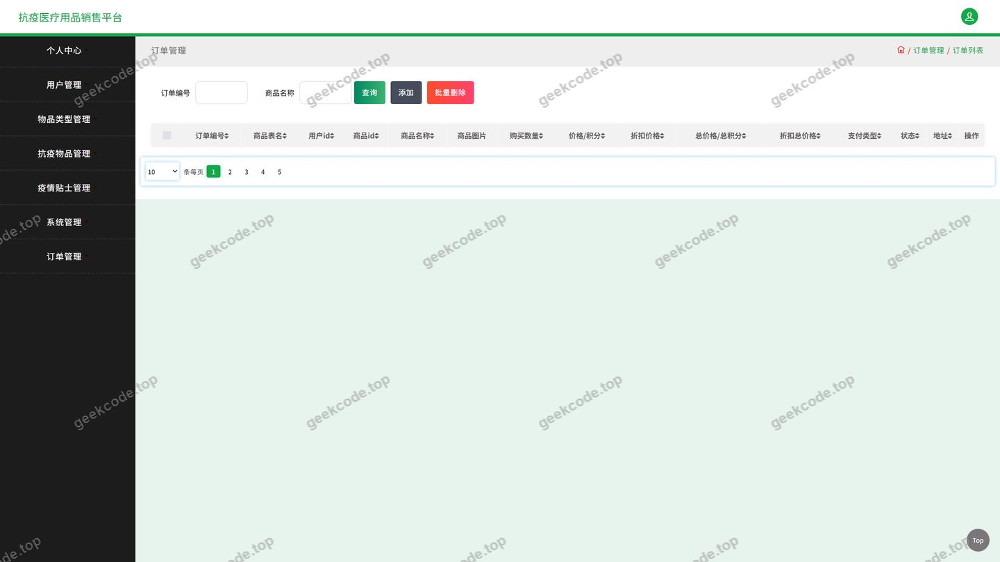
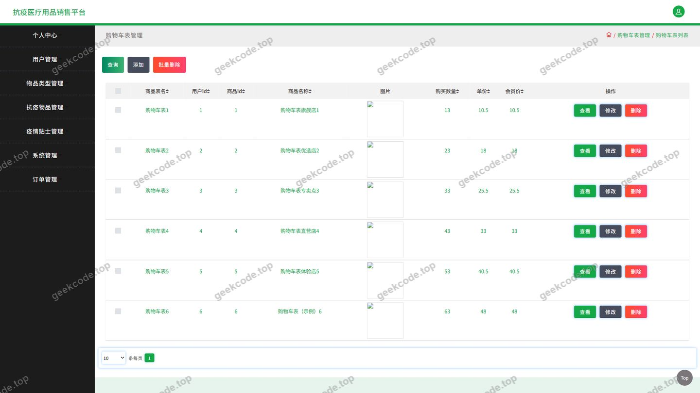
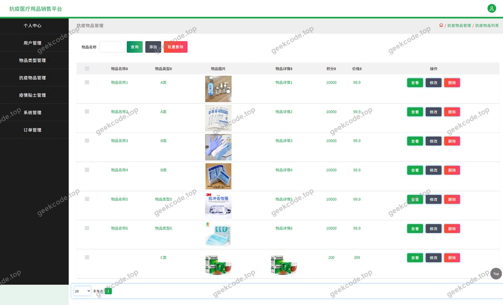
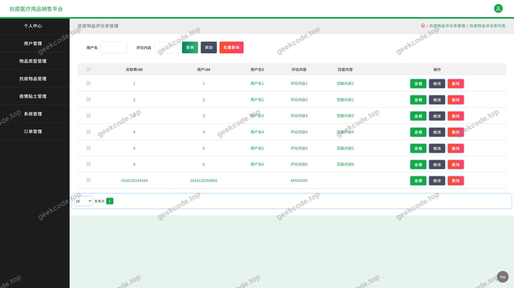
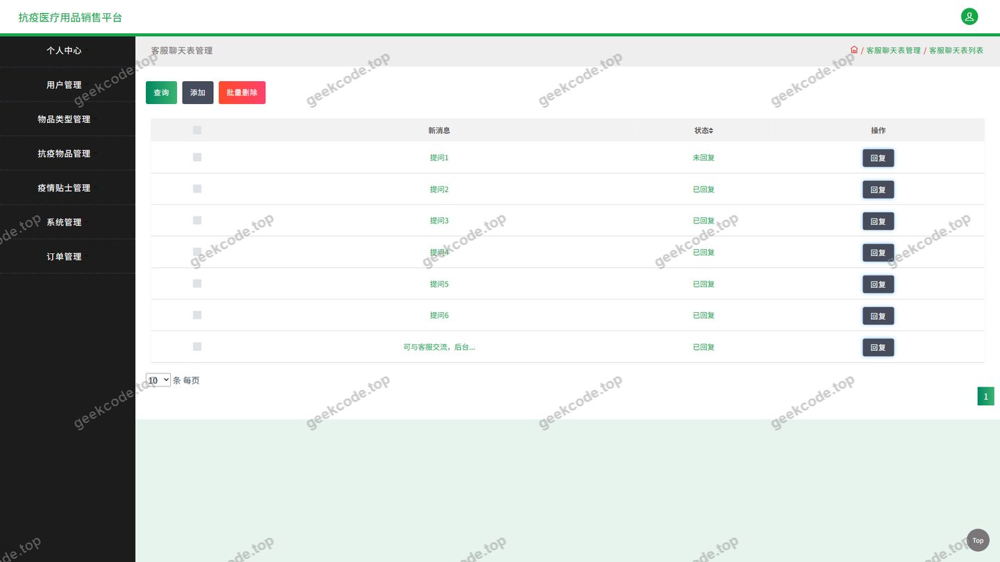
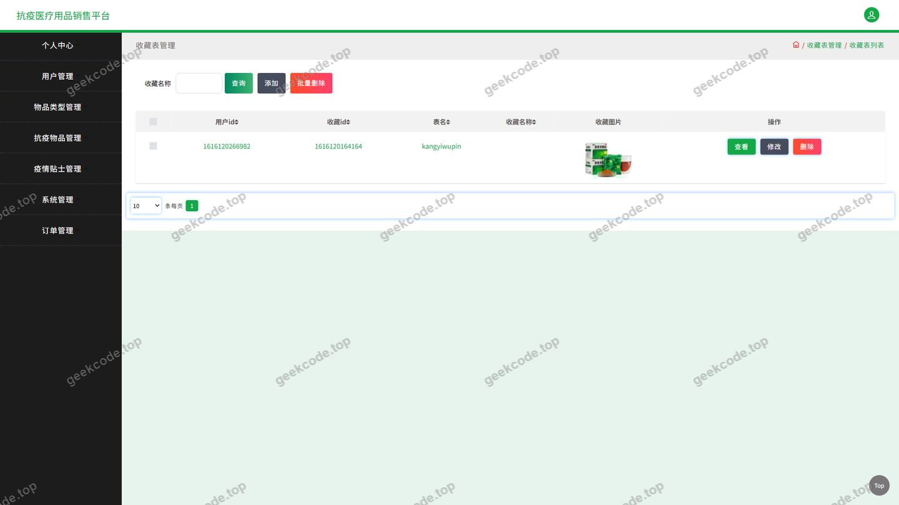
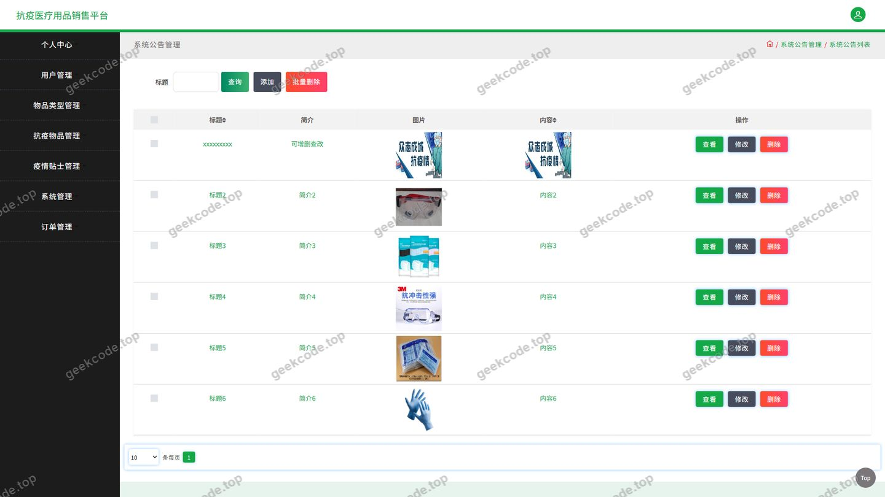
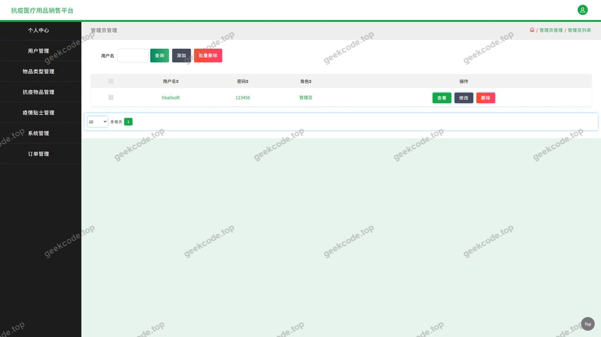

# java项目抗疫医疗用品销售平台java毕业设计

> 🎓 **计算机毕业设计 · java项目抗疫医疗用品销售平台java毕业设计**
>
> 本仓库只放**项目介绍 + 运行截图**（截图是站点带水印的原图，存在仓库 `images/` 里）。
>
> 👉 **完整可运行源码 / 数据库脚本 / 部署文档：[点我获取](https://geekcode.top/archives/java%E9%A1%B9%E7%9B%AE%E6%8A%97%E7%96%AB%E5%8C%BB%E7%96%97%E7%94%A8%E5%93%81%E9%94%80%E5%94%AE%E5%B9%B3%E5%8F%B0java%E6%AF%95%E4%B8%9A%E8%AE%BE%E8%AE%A1?utm_source=github)**
>
> 💬 咨询微信：**ir9372**　|　🌐 更多项目：[极客代码 geekcode.top](https://geekcode.top/?utm_source=github)
>
> 📌 项目详情页：<https://geekcode.top/archives/java%E9%A1%B9%E7%9B%AE%E6%8A%97%E7%96%AB%E5%8C%BB%E7%96%97%E7%94%A8%E5%93%81%E9%94%80%E5%94%AE%E5%B9%B3%E5%8F%B0java%E6%AF%95%E4%B8%9A%E8%AE%BE%E8%AE%A1?utm_source=github>

<table><td width="230" align="center"> <b>扫码加微信 ir9372</b></td><td valign="middle">📦 源码 = 项目介绍 + 全部运行截图 + 数据库 + 部署文档 👉 点上方任意截图，直接跳到 <b>极客代码 geekcode.top</b> 详情页</td></table>

---

<h1>java项目_抗疫医疗用品销售平台_java毕业设计</h1>
<h2>项目概述</h2>

本项目为抗疫医疗用品销售平台的 Java 后端服务，采用纯 API 架构，对外提供 RESTful 风格的 HTTP 接口，覆盖抗疫物品展示、购物车、订单、收货地址、收藏、商品评论、新闻资讯、系统公告、在线客服与用户管理等业务。系统面向两类使用者：一是需要线上浏览与购买口罩、消毒用品等抗疫物资的普通用户；二是负责维护商品、订单、资讯与用户数据的管理与运营人员。

技术架构上，项目基于 Spring + Spring MVC 构建 Web 层，以 MyBatis-Plus 作为持久层框架完成对象关系映射与单表 CRUD，使用 Druid 作为数据库连接池，并通过 JUnit 支撑单元测试。项目自身不包含前端工程，配套页面（登录、购物车、抗疫物品、订单、收藏、用户、聊天客服、评论、系统公告等）通过调用本服务提供的接口完成数据交互，实现前后端解耦，便于 Web 端与移动端复用同一套服务。

<h2>技术架构</h2>
<h3>整体架构</h3>

项目采用典型的分层架构，自上而下为接口层、业务层、持久层与数据层。接口层由 12 个 Controller 组成，负责接收 HTTP 请求、参数校验与结果返回；业务层承载订单、购物车、收藏等业务规则；持久层基于 MyBatis-Plus 的通用 Mapper 完成数据库访问；数据层为 MySQL 数据库，连接由 Druid 连接池统一管理。

接口层由以下控制器构成，均以 REST 风格对外暴露资源：

<table>
<thead>
<tr>
<th>控制器</th>
<th>职责</th>
</tr>
</thead>
<tbody><tr>
<td>UserController</td>
<td>用户账号相关接口</td>
</tr>
<tr>
<td>KangyiwupinController</td>
<td>抗疫物品信息接口</td>
</tr>
<tr>
<td>OrdersController</td>
<td>订单业务接口</td>
</tr>
<tr>
<td>CartController</td>
<td>购物车接口</td>
</tr>
<tr>
<td>AddressController</td>
<td>收货地址接口</td>
</tr>
<tr>
<td>StoreupController</td>
<td>收藏接口</td>
</tr>
<tr>
<td>DiscusskangyiwupinController</td>
<td>抗疫物品评论接口</td>
</tr>
<tr>
<td>NewsController</td>
<td>新闻资讯接口</td>
</tr>
<tr>
<td>ChatController</td>
<td>在线客服聊天接口</td>
</tr>
<tr>
<td>CommonController</td>
<td>通用数据接口</td>
</tr>
<tr>
<td>ConfigController</td>
<td>系统配置接口</td>
</tr>
<tr>
<td>FileController</td>
<td>文件上传与访问接口</td>
</tr>
</tbody></table>
<h3>数据库设计要点</h3>

数据库表与业务实体一一对应，围绕电商交易主链路与内容服务两条主线组织：

<ul>
<li>交易主线：用户（UserController）→ 收货地址（AddressController）→ 购物车（CartController）→ 订单（OrdersController），订单与用户、物品、地址之间存在关联关系。</li>
<li>互动主线：收藏（StoreupController）、评论（DiscusskangyiwupinController）关联用户与抗疫物品，形成用户与商品之间的多对多互动关系。</li>
<li>内容主线：抗疫物品（KangyiwupinController）、新闻资讯（NewsController）、系统公告、在线客服消息（ChatController）与系统配置（ConfigController）作为独立业务表维护。</li>
</ul>

持久层使用 MyBatis-Plus，通过通用 Mapper 与条件构造器完成单表增删改查与条件查询，减少手写 SQL；实体与表字段的具体映射细节以项目中的实体类与 Mapper 配置为准。

<h3>核心技术选型理由</h3>
<ul>
<li><strong>Spring + Spring MVC</strong>：利用 IoC 容器管理 Controller、Service 等组件，通过 AOP 处理横切逻辑；Spring MVC 提供注解式请求映射与参数绑定，便于构建规范化的 HTTP 接口。</li>
<li><strong>MyBatis-Plus</strong>：在 MyBatis 基础上提供通用 CRUD、条件构造器与分页能力，契合本项目中大量单表查询与后台数据维护的场景，显著减少样板代码。</li>
<li><strong>Druid</strong>：作为高性能数据库连接池，提供连接复用与 SQL 执行监控能力，便于在开发与运行阶段观察数据库访问状况。</li>
<li><strong>JUnit</strong>：为业务逻辑与接口提供单元测试支持，保证核心流程的可验证性。</li>
</ul>
<h2>功能模块</h2>
<h3>用户端功能模块</h3>

项目为纯 API 工程，用户端功能以接口形式提供，由配套页面调用，对应截图中的登录、购物车、抗疫物品、抗疫物品评论、订单、收藏、聊天客服等页面。

<ul>
<li><strong>用户账号模块（UserController）</strong>：提供登录、注册及用户个人信息相关接口，是购物车、订单、收藏等业务的身份基础。</li>
<li><strong>抗疫物品模块（KangyiwupinController）</strong>：提供抗疫物品的列表查询与详情查询接口，支撑首页与列表页的商品展示。</li>
<li><strong>购物车模块（CartController）</strong>：提供加入购物车、购物车列表查询、数量调整与删除等接口，对应购物车页面。</li>
<li><strong>订单模块（OrdersController）</strong>：提供下单、订单列表查询与订单详情查询等接口，对应&quot;我的订单&quot;与订单页面。</li>
<li><strong>收货地址模块（AddressController）</strong>：提供收货地址的增删改查接口，对应&quot;我的地址&quot;入口，为下单流程提供地址数据。</li>
<li><strong>收藏模块（StoreupController）</strong>：提供收藏、取消收藏与收藏列表查询接口，对应&quot;我的收藏&quot;与收藏页面。</li>
<li><strong>评论模块（DiscusskangyiwupinController）</strong>：提供抗疫物品评论的提交与列表查询接口，对应抗疫物品评论页面。</li>
<li><strong>新闻资讯模块（NewsController）</strong>：提供新闻资讯的列表与详情接口，支撑前台&quot;新闻资讯&quot;栏目。</li>
<li><strong>在线客服模块（ChatController）</strong>：提供客服会话与消息相关接口，对应聊天客服页面。</li>
<li><strong>通用与文件模块（CommonController、FileController）</strong>：CommonController 提供通用数据接口，FileController 提供文件上传与访问能力，供商品图片、用户头像等资源使用。</li>
</ul>

前台导航中的&quot;疫情贴士&quot;栏目，其内容所对应的具体接口在现有代码上下文中未见独立控制器，根据现有信息无法确定其数据来源。

<h3>管理端功能模块</h3>

项目未内置独立的后台管理前端路由，管理侧功能通过同一套接口完成数据维护，具体管理界面不在本工程范围内。

<ul>
<li><strong>用户管理（UserController）</strong>：对平台注册用户信息进行查询与维护。</li>
<li><strong>抗疫物品管理（KangyiwupinController）</strong>：对抗疫物品信息进行新增、修改、删除与查询，是商品数据的上游维护入口。</li>
<li><strong>订单管理（OrdersController）</strong>：查询与处理平台订单数据。</li>
<li><strong>评论管理（DiscusskangyiwupinController）</strong>：查看与处理抗疫物品评论数据。</li>
<li><strong>新闻资讯与公告管理（NewsController）</strong>：维护新闻资讯内容，支撑前台资讯栏目与系统公告展示。</li>
<li><strong>系统配置管理（ConfigController）</strong>：维护平台运行相关的配置项。</li>
<li><strong>文件管理（FileController）</strong>：统一处理图片等文件资源的上传与访问。</li>
<li><strong>通用数据管理（CommonController）</strong>：为各业务模块提供通用数据支撑。</li>
</ul>
<h2>用户角色与权限</h2>

系统使用者划分为普通用户与管理员两类角色。

<h3>普通用户</h3>

普通用户面向交易与内容消费场景，可访问以下功能模块：

<ul>
<li>账号模块：登录、注册、个人信息的查询与修改。</li>
<li>抗疫物品模块：抗疫物品列表与详情浏览。</li>
<li>购物车模块：加入购物车、查看购物车、修改数量、删除购物车条目。</li>
<li>订单模块：提交订单、查看我的订单、查看订单详情。</li>
<li>地址模块：收货地址的新增、修改、删除与查询（我的地址）。</li>
<li>收藏模块：收藏抗疫物品、取消收藏、查看我的收藏。</li>
<li>评论模块：查看抗疫物品评论、发表评论。</li>
<li>新闻资讯模块：浏览新闻资讯列表与详情。</li>
<li>在线客服模块：进入客服会话并收发消息。</li>
<li>通用与文件模块：获取通用数据、上传与访问文件资源。</li>
</ul>
<h3>管理员</h3>

管理员面向平台数据维护场景，可访问以下功能模块：

<ul>
<li>用户管理：查询与维护平台用户数据。</li>
<li>抗疫物品管理：抗疫物品信息的新增、修改、删除与查询。</li>
<li>订单管理：查询与处理订单数据。</li>
<li>评论管理：查看与处理评论数据。</li>
<li>新闻资讯管理：新闻资讯与公告内容的新增、修改、删除与查询。</li>
<li>系统配置管理：平台配置项的维护。</li>
<li>文件管理：文件资源的上传与访问管理。</li>
<li>通用数据管理：通用数据的维护。</li>
</ul>

两类角色共用同一套后端接口，角色差异体现在所调用的接口范围上；接口层面的鉴权与角色校验实现方式以项目中的实际拦截与校验代码为准。

<h2>项目特色与创新点</h2>
<ul>
<li><strong>垂直场景聚焦</strong>：围绕抗疫医疗用品这一特定品类构建销售平台，商品、评论、资讯等内容均贴合疫情防控场景，业务语义清晰。</li>
<li><strong>完整交易闭环</strong>：从抗疫物品浏览、加入购物车、维护收货地址，到提交订单与订单查询，形成完整的线上购买链路，并配套收藏与评论提升用户决策效率。</li>
<li><strong>交易与内容双主线</strong>：在电商能力之外，集成新闻资讯、系统公告与疫情贴士类内容服务，使平台兼具物资供应与信息发布双重价值。</li>
<li><strong>内置在线客服</strong>：通过 ChatController 提供会话与消息接口，为用户咨询物资信息提供直接通道，降低沟通成本。</li>
<li><strong>纯 API 架构与前后端解耦</strong>：后端仅暴露标准化 HTTP 接口，不绑定具体前端实现，配套页面与后续多端应用可复用同一套服务。</li>
<li><strong>持久层效率优化</strong>：借助 MyBatis-Plus 的通用 CRUD 与条件构造能力减少重复 SQL 编写，结合 Druid 连接池提升数据库访问性能并保留监控能力。</li>
</ul>
<h2>部署环境</h2>
<table>
<thead>
<tr>
<th>类别</th>
<th>要求</th>
</tr>
</thead>
<tbody><tr>
<td>开发语言</td>
<td>Java（JDK 8 及以上）</td>
</tr>
<tr>
<td>Web 框架</td>
<td>Spring、Spring MVC</td>
</tr>
<tr>
<td>持久层框架</td>
<td>MyBatis-Plus</td>
</tr>
<tr>
<td>数据库连接池</td>
<td>Druid</td>
</tr>
<tr>
<td>数据库</td>
<td>MySQL</td>
</tr>
<tr>
<td>构建工具</td>
<td>Maven</td>
</tr>
<tr>
<td>单元测试</td>
<td>JUnit</td>
</tr>
<tr>
<td>运行容器</td>
<td>支持 Servlet 规范的 Web 容器（如 Tomcat）</td>
</tr>
<tr>
<td>接口调试</td>
<td>Postman、浏览器或配套前端页面</td>
</tr>
</tbody></table>

部署时需先创建 MySQL 数据库并导入项目提供的初始化脚本，在数据库配置文件中填写正确的连接地址、用户名与密码；随后通过 Maven 完成依赖拉取与项目构建，将应用部署至 Servlet 容器启动，即可通过接口地址访问各项服务。前端页面需单独部署，并通过配置接口基地址指向本服务。

<h2>五、技术特性</h2>
<ul>
<li>使用 MyBatis-Plus 简化数据访问层开发</li>
</ul>
<h2>六、功能模块截图</h2>
<h3>后台管理端</h3>
<h4>页面-登录</h4>

<h4>页面-订单</h4>

<h4>页面-购物车</h4>

<h4>页面-抗疫物品</h4>

<h4>页面-抗疫物品评论</h4>

<h4>页面-聊天客服</h4>

<h4>页面-收藏</h4>

<h4>页面-系统公告</h4>

<h4>页面-用户</h4>

---

## 获取完整源码

| 项目 | 说明 |
| --- | --- |
| 项目名 | java项目抗疫医疗用品销售平台java毕业设计 |
| 运行截图 | 本文 10 张（站点带水印原图，仓库 `images/` 目录） |
| 完整源码 | [https://geekcode.top/archives/java%E9%A1%B9%E7%9B%AE%E6%8A%97%E7%96%AB%E5%8C%BB%E7%96%97%E7%94%A8%E5%93%81%E9%94%80%E5%94%AE%E5%B9%B3%E5%8F%B0java%E6%AF%95%E4%B8%9A%E8%AE%BE%E8%AE%A1?utm_source=github](https://geekcode.top/archives/java%E9%A1%B9%E7%9B%AE%E6%8A%97%E7%96%AB%E5%8C%BB%E7%96%97%E7%94%A8%E5%93%81%E9%94%80%E5%94%AE%E5%B9%B3%E5%8F%B0java%E6%AF%95%E4%B8%9A%E8%AE%BE%E8%AE%A1?utm_source=github) |
| 咨询微信 | **ir9372**（备注：jingpin-yuanma） |
| 更多项目 | [极客代码 geekcode.top](https://geekcode.top/?utm_source=github) |

> 需要源码、部署、改配置、跑不起来等问题，加微信 ir9372 沟通，说明项目名即可。
